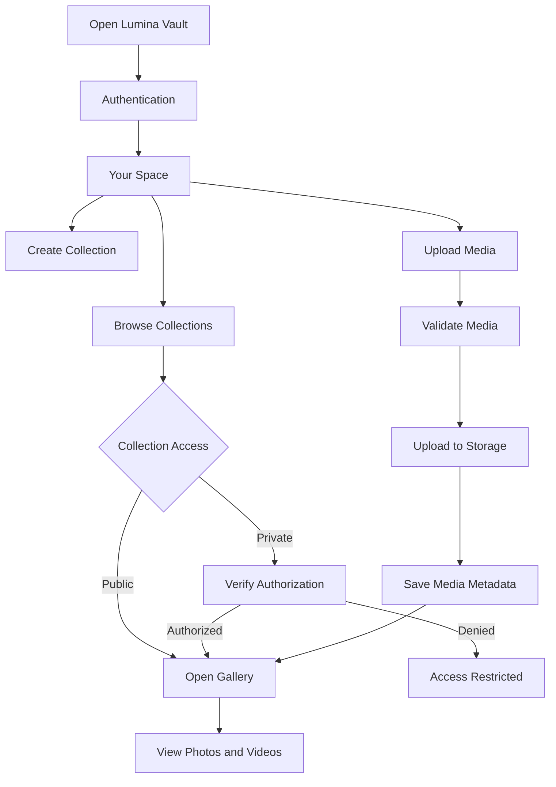
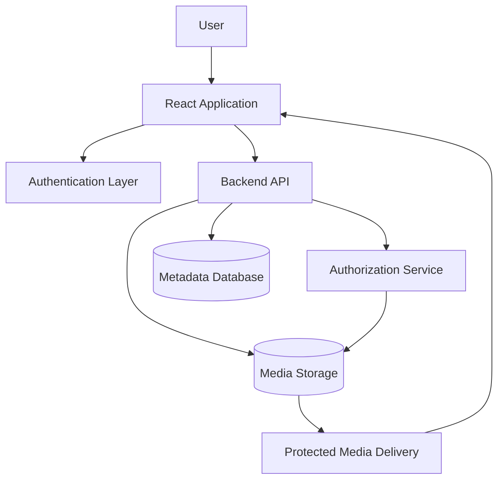

 <p align="center">
  <a href="https://github.com/Devputta/storage-walst">
    
  </a>
</p>

<h1 align="center">Lumina Vault</h1>

<p align="center">
  <strong>Your memories. Your private world.</strong><br />
  A cinematic personal media gallery designed to organize, experience, and protect photos and videos in a private digital space.
</p>

<p align="center">
  <a href="https://github.com/Devputta/storage-walst">
    
  </a>
  
  
  
  
  
</p>

<p align="center">
  <a href="#overview">Overview</a> ·
  <a href="#features">Features</a> ·
  <a href="#privacy-and-security">Privacy</a> ·
  <a href="#media-experience">Media Experience</a> ·
  <a href="#architecture">Architecture</a> ·
  <a href="#installation">Installation</a> ·
  <a href="#deployment">Deployment</a>
</p>

---

## Overview

Personal media collections deserve more than a traditional file manager.

Lumina Vault explores a different approach to storing and experiencing personal photos and videos. Instead of presenting media as file names and directory trees, it organizes memories into visual collections with a cinematic browsing experience.

The application is designed around three principles:

- **Privacy first:** Personal media should remain protected and accessible only through authorized access.
- **Visual organization:** Collections should feel like curated galleries rather than storage directories.
- **Immersive experience:** Photos and videos should be enjoyable to browse, preview, and revisit.

Lumina Vault aims to combine personal media management with a clean, distraction-free interface.

## Features

### Visual collections

Organize personal media into collections with individual visual identities.

- Create new collections.
- Rename and delete collections.
- Assign cover images or videos.
- Organize media by collection.
- Open collections in dedicated gallery views.
- Search and filter collections.

### Privacy and access control

Privacy is a core part of the product design.

The intended privacy experience includes:

- Login or PIN-based access.
- Private and public collection visibility.
- Locked collections.
- Blurred previews for protected collections.
- Invisible collections.
- Automatic locking after inactivity.
- Controlled access to private media.

**Security note:** A blurred thumbnail or client-side PIN screen alone does not provide real media protection. Production privacy requires server-side authorization and protected storage access.

### Cinematic media experience

A gallery experience designed around the content rather than file-management controls.

**Images**
- Fullscreen image viewing.
- Zoom and navigation.
- Gallery-based browsing.
- Favorites.

**Videos**
- Fullscreen playback.
- Playback speed controls.
- Video quality selection when supported by the source.
- Download controls where permitted.

### Media upload

A streamlined upload experience.

- Drag-and-drop media selection.
- Upload directly into a collection.
- Preview before uploading.
- Add a media title.
- Add descriptions.
- Select a destination collection.
- Display upload progress.
- Support common photo and video formats.

### Smart organization

- Search collections and media.
- Filter photos and videos.
- Mark favorite media.
- Organize content into collections.
- Access hidden collections through the appropriate unlock flow.

## Privacy and Security

Lumina Vault is designed with privacy as a product requirement, not simply a visual feature.

The security architecture should distinguish between interface-level privacy and actual data protection.

| Area | Intended approach |
|---|---|
| Authentication | Authorized user login |
| Collection protection | Server-validated access |
| Private collections | Protected collection permissions |
| Hidden mode | Excluded from normal collection listings |
| Media access | Authorized media delivery |
| Inactivity | Automatic session locking |
| Secrets | Environment-based configuration |

### Important security requirements

- Never store passwords or PINs as plaintext.
- Never expose storage credentials in frontend code.
- Validate collection permissions on the server.
- Protect media URLs and storage access.
- Validate uploaded file types and sizes.
- Use secure session management.
- Avoid treating hidden routes as authentication.
- Do not expose private media through publicly accessible storage URLs.

The actual security guarantees depend on the backend, authentication provider, storage configuration, and deployment environment.

## User Interface

Lumina Vault follows a cinematic design direction.

### Design principles

- Dark-first visual system.
- Minimal navigation.
- Large photographic previews.
- Editorial-style collection layouts.
- Subtle transitions and motion.
- Consistent spacing and typography.
- Responsive gallery layouts.
- Accessible controls and keyboard navigation.

### Interface sections

| Section | Purpose |
|---|---|
| Your Space | Main collection dashboard |
| Collections | Visual media organization |
| Private Vault | Protected collections |
| Favorites | Saved media |
| Media Viewer | Fullscreen media experience |
| Upload Studio | Media upload and preview |
| Security Settings | Privacy and access preferences |

## Application Flow



## Architecture

Lumina Vault is intended to use a modular frontend and a secure media-storage backend.

### High-level architecture



### Architectural responsibilities

| Layer | Responsibility |
|---|---|
| Frontend | Gallery, collections, upload interface |
| Authentication | User identity and session management |
| Backend | Application logic and validation |
| Authorization | Collection and media permissions |
| Database | Collection and media metadata |
| Storage | Original photo and video files |
| Delivery | Secure media access |

### Technology stack

| Category | Technology |
|---|---|
| Frontend | React |
| Language | TypeScript |
| Styling | Tailwind CSS |
| Animation | Framer Motion |
| Build tooling | Vite |
| Authentication | Backend authentication provider |
| Storage | Cloudinary / Firebase / Supabase |
| Database | Provider-dependent |

The final technology configuration should reflect the dependencies and services actually implemented in the repository.

## Installation

### Requirements

- Node.js compatible with the project's Vite version.
- npm.
- Git.
- A configured backend and storage provider if required by the application.

### Clone the repository

```bash
git clone https://github.com/Devputta/storage-walst.git
cd storage-walst
```

### Install dependencies

```bash
npm install
```

### Environment configuration

Create a local environment file based on the example:

```bash
cp .env.example .env
```

Configure the required environment variables according to the selected backend and storage provider.

Never commit `.env` or credentials to GitHub.

### Start development server

```bash
npm run dev
```

Open the local URL displayed in the terminal.

### Production build

```bash
npm run build
```

Preview the production build:

```bash
npm run preview
```

Check the available scripts in `package.json` before running optional commands.

## Project Structure

The following is a suggested high-level organization. Actual paths should match the repository implementation.

```text
storage-walst/
├── public/
│   └── assets/
├── src/
│   ├── components/
│   │   ├── collections/
│   │   ├── gallery/
│   │   ├── media/
│   │   ├── privacy/
│   │   └── shared/
│   ├── pages/
│   ├── hooks/
│   ├── services/
│   ├── lib/
│   ├── types/
│   ├── styles/
│   ├── App.tsx
│   └── main.tsx
├── tests/
├── docs/
├── .env.example
├── .gitignore
├── package.json
├── tsconfig.json
├── vite.config.ts
└── README.md
```

## Testing and Quality

Before deployment, verify:

- Authentication and logout behaviour.
- Collection creation, editing, and deletion.
- Private collection authorization.
- Media upload validation.
- Image and video playback.
- Favorites and search.
- Responsive behaviour.
- Session expiration and automatic locking.
- Error handling for failed uploads.
- Production build and environment configuration.

Run the test commands available in the repository's `package.json`.

## Deployment

Lumina Vault can be deployed using a hosting platform compatible with its frontend framework and backend configuration.

### Deployment checklist

1. Push the verified application to GitHub.
2. Connect the repository to the hosting provider.
3. Configure the production environment variables.
4. Configure the backend and storage provider.
5. Configure authorized domains and authentication callbacks.
6. Build the application.
7. Deploy the production output.
8. Test authentication, media access, uploads, and privacy restrictions.

### Production security checklist

- HTTPS enabled.
- No exposed API secrets.
- Storage permissions reviewed.
- Authentication callbacks configured.
- Private media access tested.
- Upload limits configured.
- Database access policies reviewed.
- Backup and recovery strategy considered.

## Known Limitations

The actual capabilities depend on the implemented application and configured services.

Potential limitations to document as they are verified:

- Browser support for large media files.
- Upload size restrictions.
- Storage-provider bandwidth and limits.
- Video playback compatibility.
- Network requirements for cloud media.
- Device-dependent image and video performance.
- Availability of original-resolution media.

Do not interpret a hidden collection or blurred preview as proof that its underlying media is inaccessible to unauthorized users.

## Roadmap

Potential development areas:

- [ ] Complete collection management.
- [ ] Secure authentication and session handling.
- [ ] Protected private collections.
- [ ] Invisible collection access.
- [ ] Drag-and-drop media upload.
- [ ] Fullscreen photo and video viewer.
- [ ] Favorites and advanced search.
- [ ] Automatic inactivity locking.
- [ ] Improved mobile gallery experience.
- [ ] Storage usage and media management.
- [ ] Automated security and regression tests.

Roadmap items represent development goals, not claims of completed functionality.

## Contributing

Contributions and suggestions are welcome.

1. Fork the repository.
2. Create a focused feature branch.
3. Follow the existing code structure.
4. Test changes locally.
5. Update documentation when behaviour changes.
6. Submit a pull request describing the implementation.

Avoid committing credentials, private environment files, personal media, or other sensitive information.

## Security Reporting

Please do not publish sensitive vulnerability details in public issues.

Report security concerns through the repository's private reporting mechanism, if configured. Include the affected functionality and reproducible details without exposing private user data.

## License

See the repository's `LICENSE` file for the applicable licensing terms.

---

<p align="center">
  <strong>Lumina Vault</strong><br />
  A private space for the moments worth keeping.
</p>

<p align="center">
  <a href="https://github.com/Devputta/storage-walst">GitHub Repository</a>
</p>
